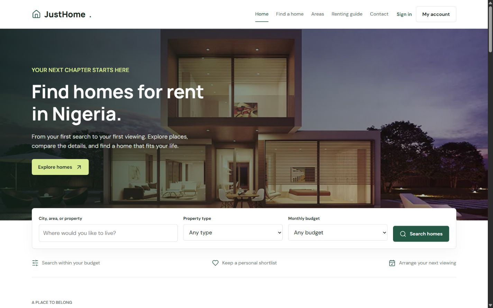

# JustHome

A real estate application for discovering homes, keeping a shortlist, and requesting viewings.

JustHome brings property search and account-based enquiries into a clear, responsive experience. Built by [Tobi](https://github.com/thobee) with JavaScript, semantic HTML, CSS, Firebase Authentication, and Cloud Firestore.



[View the mobile layout](docs/home-mobile.png)

## Features

- Area discovery for Lagos, Abuja, and Ibadan, with links to local searches.
- Practical renting guide and accessible FAQ accordions.
- Search-readable homepage content, production canonical links, structured data, and sitemap.
- Compressed WebP images and lazy loading for below-the-fold photography.
- Property search by location, home type, and monthly budget.
- Price sorting, combined filters, empty states, and additional results.
- Property photos, descriptions, availability, and rental details.
- Persistent saved homes connected to each user's Firebase account.
- Viewing requests for published, available properties.
- Email/password signup and sign-in, password visibility, and reset emails.
- Account dashboard for shortlisted homes and viewing requests.
- Contact enquiries saved in Firestore with clear submission feedback.
- Responsive navigation, labeled forms, keyboard focus states, and loading/error feedback.

## Run Locally

Requires Node.js 20 or later.

```bash
git clone https://github.com/thobee/justhome-estate.git
cd justhome-estate
npm run dev
```

Open **http://localhost:4173/**. The local static server uses Node built-ins; no dependency installation is required to start it. Live account features require internet access and correctly configured Firebase permissions.

## Listing Data

Published properties come from Firestore. Twelve example homes provide additional browsing content and are marked **Sample listing**. They are ordinary sample catalog records, not a separate app mode. They can be explored and saved after sign-in, but cannot be booked. Published properties remain the source for real viewing requests.

If published listings cannot load, the interface explains the connection problem while leaving the sample catalog available. Successful account, enquiry, and viewing actions are reported only after Firebase confirms the write.

## Architecture

```text
Public HTML pages
  └─ js/platform-app.js       Layout, rendering, navigation, forms
       ├─ js/catalog-core.js  Search, normalization, URL checks, sample homes
       └─ js/platform.js      Firebase Auth + Firestore operations

style/platform.css           Shared design tokens and responsive layouts
scripts/serve.mjs            Local static preview server
tests/catalog.test.mjs       Core behavior tests
admin/ + agent pages         Existing property management interfaces
```

## Technical Decisions

| Decision                       | Purpose                                                                  |
| ------------------------------ | ------------------------------------------------------------------------ |
| Shared public UI               | Consistent navigation, forms, and spacing across thirteen pages.         |
| Independent catalog logic      | Search and legacy data normalization can be tested without Firebase.     |
| Reused Firebase initialization | Authentication and database operations share one initialization promise. |
| Account-based persistence      | Saved homes, enquiries, and viewing requests belong to signed-in users.  |
| Escaped database text          | Dynamic listing content is escaped before rendering.                     |
| Validated sign-in destinations | Account navigation accepts supported internal pages only.                |
| Immediate catalog rendering    | Sample homes remain browsable while published listings load.             |

The public interface uses CSS instead of browser-side Tailwind compilation. Local property images, Lucide icons, and Google Fonts provide the visual assets. The current live search fetches up to 100 listings; larger catalogs need indexed queries and cursor pagination.

## Checks

```bash
npm test
npm run check
```

Tests cover composed filters, sorting, saved-only results, legacy listing fields, HTML escaping, image URLs, and sign-in continuations. Desktop/mobile browser checks also cover search, navigation, property details, empty states, and form controls.

SEO checks cover canonical URLs, structured data, visible FAQ answers, static homepage search, and public sitemap entries. The production URL is [justhome-estate.vercel.app](https://justhome-estate.vercel.app/). Local changes appear there only after deployment. Dynamic property-detail indexing still requires listing-specific metadata rendered at build time or on a server.

## Setup and Deployment

Read [Setup](docs/SETUP.md) for Firebase configuration, collections, and hosting. Firebase web configuration identifies the project publicly; database rules and trusted role assignment enforce access.

The refreshed public experience is buildless. Existing agent/admin interfaces remain in the repository, with their production access-control review tracked in [Remaining work](docs/ROADMAP.md). The supplied Firebase Hosting configuration publishes the refreshed public pages and omits legacy admin-creation and payment prototypes.

Live signup, reset email delivery, account permissions, and viewing confirmation should be validated in the project owner's Firebase environment. This repository does not claim verified listing volume or completed payments.

## Author

[Tobi](https://github.com/thobee) · [JustHome repository](https://github.com/thobee/justhome-estate)
